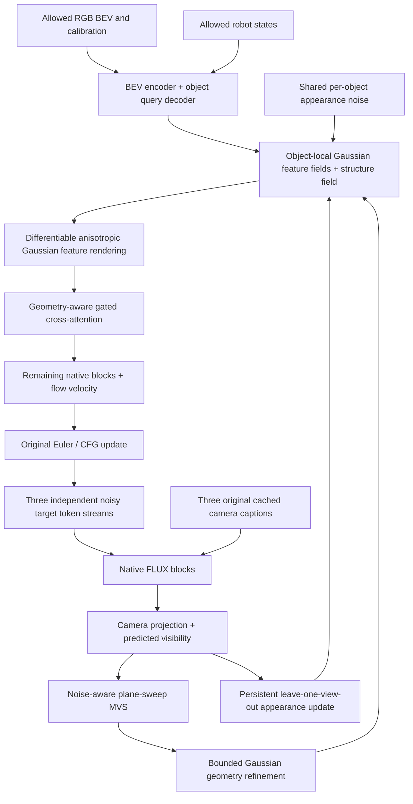

# BEV-Grounded Canonical World Diffusion

This branch implements the complete Level 1 method, initialized from the completed FLUX Base baseline. This is a research implementation, not an experimentally established optimum. CPU mathematical and native tiny-DiT checks do not establish pretrained GPU correctness, memory fit, convergence, or quality improvements.

The original `main` branch, baseline environments, dataset, sibling baselines and historical checkpoints/predictions remain unchanged. The only modified baseline entry file is `mvwd`, which dispatches `cw` commands. Historical baseline runs retain strict hashes and must use their original `main` checkout/source snapshot. New method experiments live under `artifacts/cw/experiments/` and never reuse the old training trajectory.

## Architecture



- Three views are separate native packed samples. Text/reference time remains zero, target views share a flow time, image noise is independently sampled. Only selected **target** token intervals are modified.
- Default: 128 feature channels, 1,536 predicted object queries, 32 local Gaussians/object, a spatial background field, explicit known robot support, feedback after single-stream blocks 7/15/23, 32 MVS depth candidates and two-step training unroll.
- Objects are inferred from RGB BEV. GT categories, instance IDs, boxes, poses and depth are never forwarded into the inference encoder/feedback.
- Learned object class/token, full SO(3) pose, canonical local Gaussian positions, covariance/orientation, opacity and shared features coexist. Center uncertainty is supervised by heteroscedastic likelihood and supplies a learned geometry prior, separate from rendered coverage. Their geometry is anchored to the initial predicted world; refinements are bounded.
- MVS uses predicted geometry and generated DiT features, not GT correspondences. Confidence depends on match contrast/entropy, support and actual noise time. Identical-camera/unsupported/ambiguous matches provide no geometry evidence. This cannot guarantee perfectly correct correspondence on generated features.
- Every destination's appearance memory excludes its own current **and historical** observation writes. BEV features provide a prior where other views have no evidence. Shared geometry may use all cameras.
- Geometry-aware cross-attention includes depth/coverage and spatial bias; its output projection starts at zero. View-dependent residual features are separate from the invariant field. The shared memory persists through all denoising stages. CFG branches have separate memory histories.
- Flow matching remains the primary image objective. No Gaussian RGB/latent overwrites the noisy image state.

The complete joint configuration is the default. New modules use LR 1e-4; baseline LoRA uses LR 1e-5 with a 500-update ramp, preserving the pretrained image prior while the world modules begin learning. Small tensor tests exercise the same modules; no lightweight model or intentionally defective baseline is trained. Auxiliary `world`/`fusion` stage controls are implementation support, not claimed experiments or completed ablations. Default hyperparameters are engineering choices that require validation, not proven best settings.

## Available supervision

The audit checks payload modality names across all 50 scenes without decoding test target arrays. A real train example and teacher forward are also checked.

| Label | Available | Usage / limitation |
|---|---|---|
| Perspective RGB | Yes | Three synchronous flow targets; GT only in train/val preparation/loss |
| Semantic | 253 shared classes | BEV and perspective semantic supervision; vocabulary checksum pinned |
| Instance | Integer masks + scene-scoped catalog | Map to `object_state_id`; IDs 1/2/3 are reserved robots, not missing objects |
| Object poses and world AABB | Yes | Set matching, center/extent/full SO(3) orientation; an AABB is not an oriented box |
| Depth | Yes, with invalid `inf` | Per-modality camera calibration; valid-surface depth and observed-ray free space |
| Normal arrays | Yes | Available; method uses normals derived consistently from calibrated depth |
| BEV height / occupancy | Yes | Signed height relative to local origin; observed 2D occupancy, not complete 3D volume |
| Complete 3D occupancy | No verified dense volume | Never mark unobserved space free; only supervise valid observed rays |
| Canonical textures / material BRDF | No verified labels | Frozen DINO feature targets and shared appearance learning instead |

Full scene states and masks are **privileged training targets**. Reading `state_before.json` or BEV instance masks at test inference would change the task and is prohibited. No simulator, test scene mesh, world/after BEV, events or after-state is needed.

Default output remains **256×448, full FOV**, with the same fixed two frames/episode and three robots. The proposal's suggested square resolution is not used. Synchronous grouping changes padding and batch semantics: at four ranks × accumulation 4, one frame/rank gives effective 16 frames / 48 views; unique view support remains 111,582 per epoch. Additional supervision must be disclosed when comparing to RGB-only baselines. Initialization already inherits the baseline's 10 epochs, and this default recipe adds 10 method epochs: report both inherited and incremental data/compute budgets; do not call it equal-total-budget training against a baseline trained only once.

## Setup and commands

```bash
./mvwd cw setup
./mvwd cw doctor
./mvwd cw audit --dataset /path/to/MultiViewWorldDataset_v1 \
  --output artifacts/cw/audits/UNIQUE_NAME
```

`envs/cw-diffusion` reuses baseline packages read-only through a `.pth` and installs pinned additions there, including the Ninja executable. `envs/flux3-klein` is not updated. CUDA compilation/cache files stay in the workspace. This cluster provides CUDA 13.0.2, matching the native Torch CUDA 13 major version; override `CW_CUDA_HOME` when appropriate. The launcher handles the cluster's `targets/x86_64-linux` CUDA header/library layout and prevents inherited CPU binding from conflicting with the supplied allocation. It defaults to H100 architecture `9.0`; override `TORCH_CUDA_ARCH_LIST` for other hardware.

Before freezing a long experiment, run the explicit pretrained GPU acceptance on an allocation supplied by the user:

```bash
./slurm/cw_existing_allocation.sh JOB_ID validate-gpu \
  --config configs/cw/full.json --output artifacts/cw/verification/UNIQUE_GPU_CHECK
```

It checks zero-adapter pretrained velocity equivalence, actual gsplat CUDA forward/backward, CPU/CUDA anisotropic-renderer numerical and gradient agreement, the full two-step method loss, nonzero world/feedback gradients and peak memory. It performs no optimizer updates. After single-GPU acceptance, use `./slurm/cw_existing_allocation.sh JOB_ID validate-gpu-ddp --config configs/cw/full.json --output artifacts/cw/verification/UNIQUE_DDP_CHECK` to verify four-rank forward/backward, synchronized gradients and per-rank memory without optimizer updates. Both checks passed on allocation 132110; see the exact scope and results in [GPU validation](GPU_VALIDATION.md).

Once GPU acceptance passes and source/config are finalized:

```bash
./mvwd cw init 20261117_cw_full_v1 --config configs/cw/full.json
./slurm/cw_existing_allocation.sh JOB_ID prepare 20261117_cw_full_v1 --split train
./slurm/cw_existing_allocation.sh JOB_ID prepare 20261117_cw_full_v1 --split val
./slurm/cw_existing_allocation.sh JOB_ID train 20261117_cw_full_v1 joint_a000
# Resume complete method/optimizer/RNG state using a NEW attempt name:
./slurm/cw_existing_allocation.sh NEXT_JOB_ID train 20261117_cw_full_v1 joint_a001 \
  --resume /absolute/path/to/joint_a000/step_00000500
```

Preparation validates and reuses the old baseline VAE targets/references, computes frozen DINO teacher features, and stores grouped supervision. Labels are decoded once per episode/frame pair where possible. Static BEV tensors are deduplicated per rank/configuration/floor. RGB is stored losslessly as uint8, semantic/instance integers retain exact values, geometry stays FP32, and teacher features use explicit BF16 storage. The parent baseline stores online text prompts rather than multi-terabyte cached text embeddings. Cache rows are atomic/checksummed; preparation retries use `--name prepare_train_a001` (or another unique name), while completed cache rows are retained. Do not overwrite failed step receipts.

All CUDA commands are explicit and use existing `srun --jobid`; no `salloc`/`sbatch` is performed. Keep long runs inside tmux. Run initialization only after GPU-driven code fixes are finished, because all method source, environment, class vocabulary, native cache and initialization contracts are frozen.

For the separately user-authorized batch path, see [budget-aware sbatch resume](BATCH_RESUME.md). That launcher submits one four-GPU batch allocation for the longest feasible time, resumes the same frozen trajectory and requests a complete checkpoint before normal walltime termination. The existing-allocation commands above continue to submit no allocations.

## Inference and evaluation

```bash
./slurm/cw_existing_allocation.sh JOB_ID infer EXP test42 \
  --checkpoint /absolute/path/to/final --seed 42
# If an allocation expires, keep complete triplets in the original output:
./slurm/cw_existing_allocation.sh NEXT_JOB_ID infer EXP test42_a001 \
  --checkpoint /absolute/path/to/final --seed 42 \
  --resume-predictions /absolute/path/to/EXP/predictions/test42
# Repeat complete generation for names test43/test44 and seeds 43/44.
# After complete generation, export CPU GT / BEV / multiview comparisons:
./mvwd cw review EXP test42_review --predictions /absolute/path/to/EXP/predictions/test42
./slurm/cw_existing_allocation.sh JOB_ID eval EXP test_k3 \
  --predictions /absolute/path/to/test42 /absolute/path/to/test43 /absolute/path/to/test44
```

Every completed synchronous triplet is committed by atomic directory rename with a file-checksummed receipt. Resume validates the whole generation identity, retains completed triplets and failed staging artifacts, and can redistribute remaining frames across ranks. Predicted world depth/coverage/semantic diagnostics are saved with their own K/T at quarter resolution; these are generated model outputs, not GT.

The three seeds share the same frozen per-camera captions; three cameras do not share one caption. World appearance noise is shared within the synchronous frame. Native image noise retains the old per-query seed rule. Never carry memory across unrelated episodes or frames. Test targets are unavailable to method preparation and training; GT is read only after completed generation by the existing evaluator/review.

Formal scores require all three seeds and complete original test query support. A subset needs `--preview`; it is not a formal score. The training teacher and the MV metric share a DINO backbone family; report this and assess image quality plus independent depth/layout diagnostics rather than relying on MV alone.

This implementation does not claim Level 2 editing, temporal/Level 3 modeling, proved novel geometry, or measured quality gains.

## Validation and implementation files

- `data.py`, `audit.py`: conditions/targets separation and real-data inventory.
- `world.py`: predicted object-centric fields, appearance prior, structure and robots.
- `geometry.py`, `rendering.py`: pixel-center conventions and anisotropic rendering.
- `mvs.py`, `feedback.py`: matching, uncertainty, bounded updates, leave-one-out memories.
- `native.py`, `system.py`: native token preservation and full coupled losses/unroll.
- `losses.py`: set/layout, calibrated geometry, teacher appearance, GT-surface and instance losses.
- `workflow.py`, `training.py`, `inference.py`, `checkpoint.py`: immutable/cache/resume/runtime interfaces.
- `gpu_validation.py`: genuine pretrained acceptance, distinct from CPU tests.

```bash
OMP_NUM_THREADS=2 MKL_NUM_THREADS=2 \
  PYTHONPATH="$PWD/vendor/flux3/src:$PWD" \
  ../../envs/cw-diffusion/bin/python -m pytest tests/cw -q
```

The CPU renderer is an anisotropic Gaussian numerical oracle with matching alpha cutoff and exclusive transmittance termination. CUDA training explicitly requires gsplat and never silently falls back to the CPU implementation. CPU/CUDA numerical and gradient agreement and the full pretrained path were measured on H100; these measurements do not establish optimization stability or trained quality.

Method inspirations / primary references: [gsplat 1.5.3 API](https://docs.gsplat.studio/versions/1.5.3/apis/rasterization.html), [GeoNVS paper](https://arxiv.org/abs/2603.14965). The method here infers geometry from BEV and generated features; it does not assume GeoNVS's perspective-reference Gaussian prior.
